# UniTimetable

A web app for my university (Lebanese University, Faculty of Technology, Saida) where students
and teachers check their timetable and get notified when a class is cancelled, moved or changes room.
Before this, timetables were sent as PDF files by the class delegates, and changes went through
WhatsApp groups.

Senior project of my Bachelor's in Computer & Communication Network Engineering (2024-2025),
supervised by Dr. Samia Bahlak, with guidance from Eng. Mohamed Bahlak and Eng. Rime Bahlak.
The full report is in [`docs/Senior_project_Report.pdf`](docs/Senior_project_Report.pdf).

**In short:** React + TypeScript, Tailwind CSS, Node.js + Express, PostgreSQL, JWT, bcrypt,
email with Nodemailer, Python scripts to load the data.


## Who uses it

There are three kinds of users. Each one only sees its own pages.

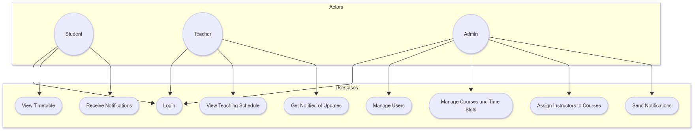

## A tour of the website

### 1. Logging in

Users log in with their email and password. Passwords are hashed with bcrypt, and the session
uses a JWT token.

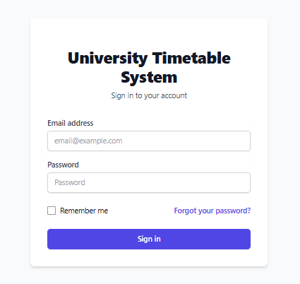

### 2. Forgot password

The user enters their email, receives a reset link by email (it expires after 1 hour), and
chooses a new password.

| Ask for a reset | Confirmation |
|---|---|
| 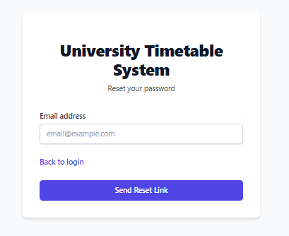 | 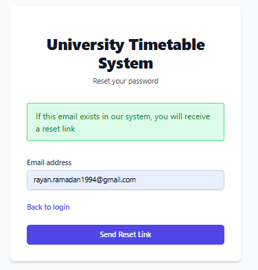 |

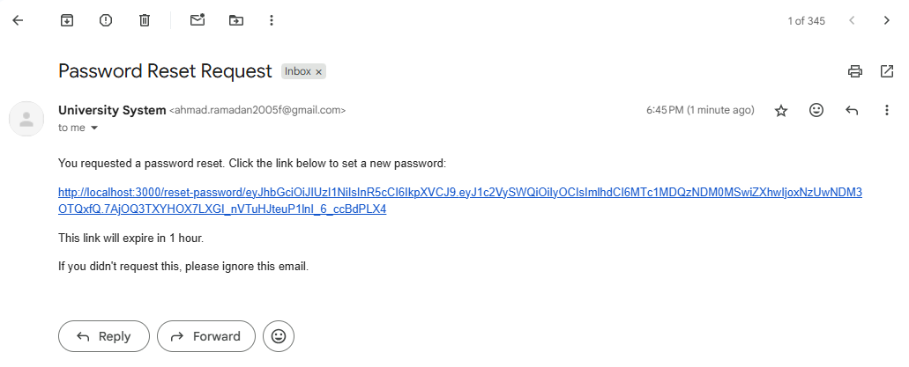

| New password | Done |
|---|---|
| 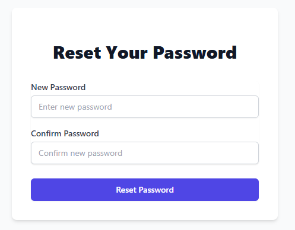 | 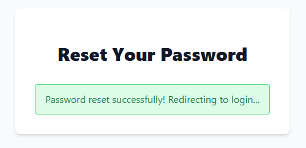 |

### 3. Student and teacher schedules

Students see the sessions of their class group, and teachers see the sessions they teach.
Each session shows the course, its code, the teacher, the room and the type (Course, TD or TP).
The week can be filtered by year, academic year, language, class group, TD group, TP group
and a range of weeks.

| Student | Teacher |
|---|---|
|  | 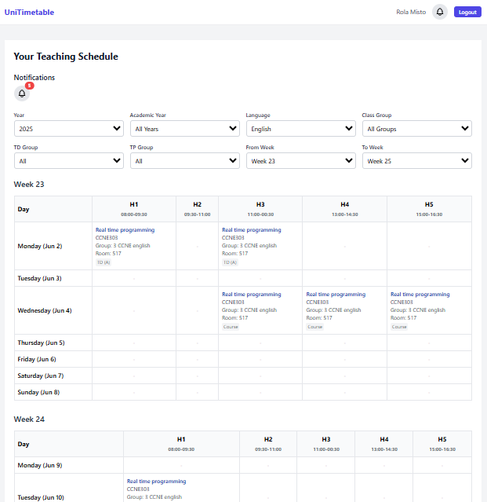 |

### 4. Notifications

The bell shows the unread notifications of the user's class group (or, for a teacher, of the
sessions they teach): cancellations, reschedules, room changes and exam announcements.

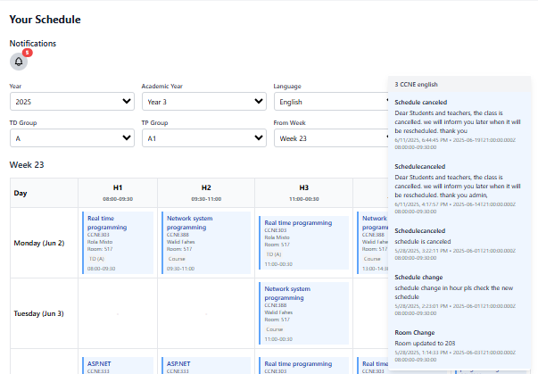

### 5. Admin dashboard

The number of users and courses, the recent activity, and a chart of the schedule changes over
the last 30 days.


The course session dashboard shows, for each course, how many sessions are done out of the
total, for Course, TD and TP, with filters by course name, semester, year and session type.

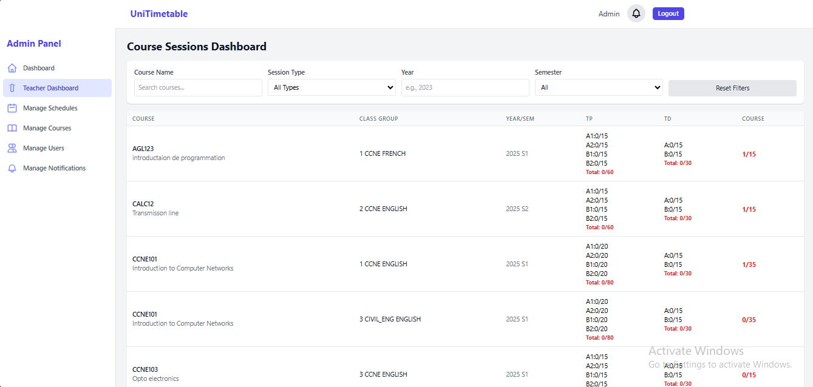

### 6. Managing schedules

The admin adds sessions (Course, TD or TP), edits, cancels or reschedules them, and filters by
year, major, section, teacher and dates. Every cancellation or reschedule is saved in a history
table. A session must last 1 hour 30 minutes to fit in the timetable grid.


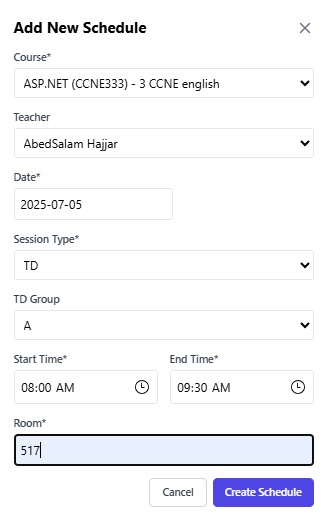

### 7. Managing courses

Add, edit or delete courses, with their code, name, description, hours and semester.

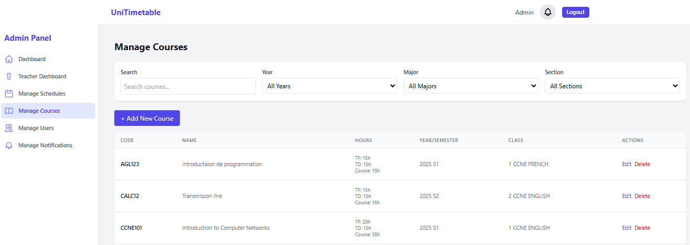

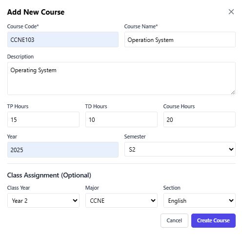

### 8. Managing users

Add, edit or delete students, teachers and admins, with filters by role, year, major and section.
A new student is placed in a class group, with a TD group and a TP group.

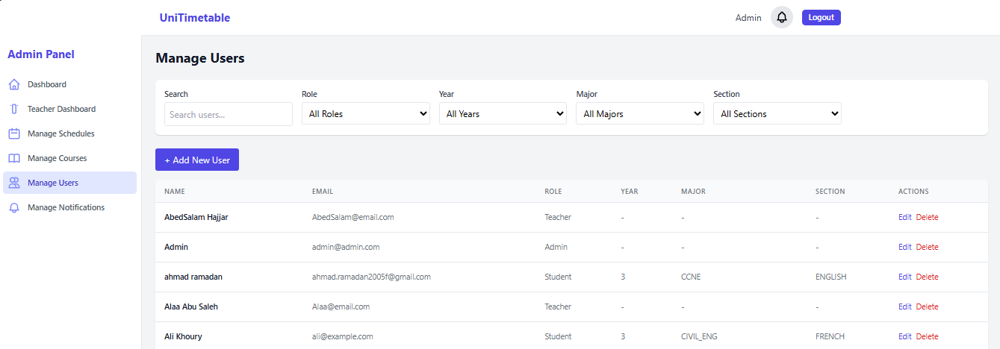

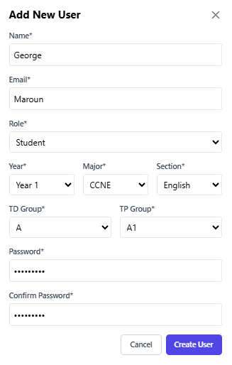

### 9. Sending notifications

The admin writes a notification for a class group. It appears in the app, and it is also sent
by email to the students of that group.

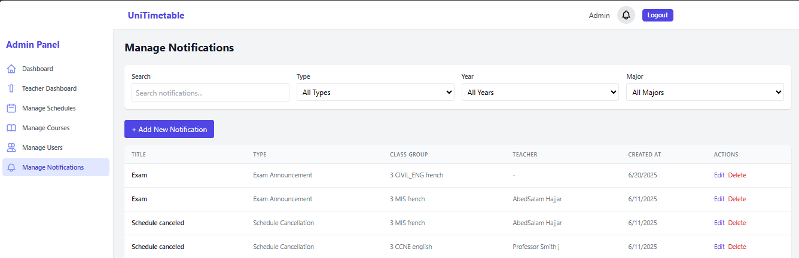

| Writing it | The email students receive |
|---|---|
| 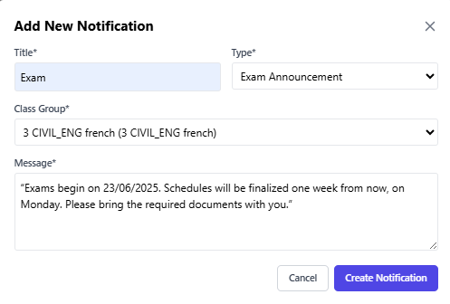 | 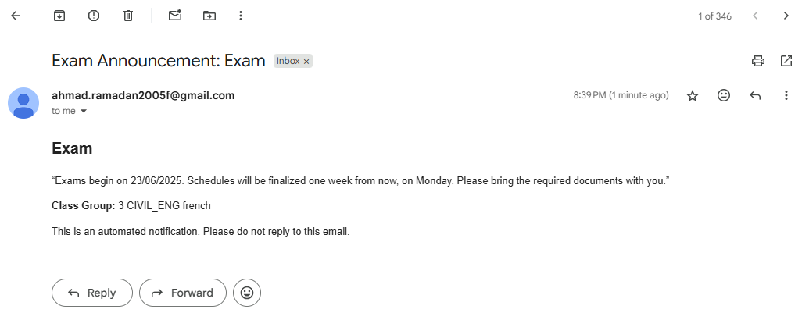 |

### 10. On a phone

The pages adapt to small screens, and the admin sidebar becomes a menu.

| Schedule | Admin menu |
|---|---|
| 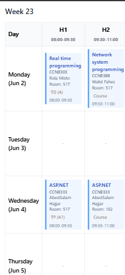 | 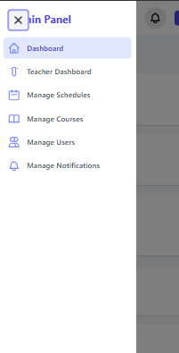 |

## Database

9 PostgreSQL tables, in [`database/schema.sql`](database/schema.sql):


- `users` holds the students, teachers and admins, with a role.
- `class_groups` are the classes (year, major, English or French section), and `student_enrollments`
  puts each student in a class group with a TD and TP group.
- `courses` are linked to class groups through `course_offerings`, and each session of a course is a
  row in `schedules` (date, start and end time, room, type, group, teacher).
- `schedule_changes` keeps the history of cancellations and reschedules, `notifications` the messages
  sent to class groups, and `password_reset_tokens` the reset links.

The data (class groups, admins, teachers, students) was loaded with the Python scripts in
[`database/injection/`](database/injection/), which read CSV files. The CSV files are not in this
repo because they contain real names and emails.

## Run it

You need Node.js and PostgreSQL.

```bash
# 1. database
createdb unitimetable
psql -d unitimetable -f database/schema.sql

# 2. backend (port 8080)
cd backend
cp .env.example .env      # fill in the database login, a JWT secret and an email account
npm install
npm start

# 3. frontend (port 3000)
cd ../frontend
npm install
npm start
```

The frontend calls the backend at `http://localhost:8080`.

## Files

```
frontend/src/pages/       login, reset password, student and teacher schedules, admin pages
frontend/src/components/  navbar, admin sidebar, notification bell
frontend/src/services/    calls to the backend API
backend/src/routes/       API routes
backend/src/controllers/  logic for auth, users, courses, schedules, notifications, emails, dashboards
backend/src/middleware/   checks the JWT token and the admin role
database/schema.sql       the tables
database/injection/       Python scripts that loaded the data from CSV files
docs/                     report and screenshots
```

## How it was built

I worked in weekly cycles, with a meeting every week to show progress and get feedback. The code was
on GitLab with a `frontend-update` branch, a `backend-update` branch, and `main` for the stable version.
The APIs were tested with Postman during development.
