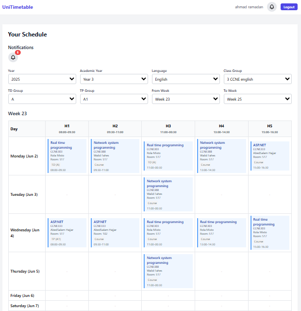
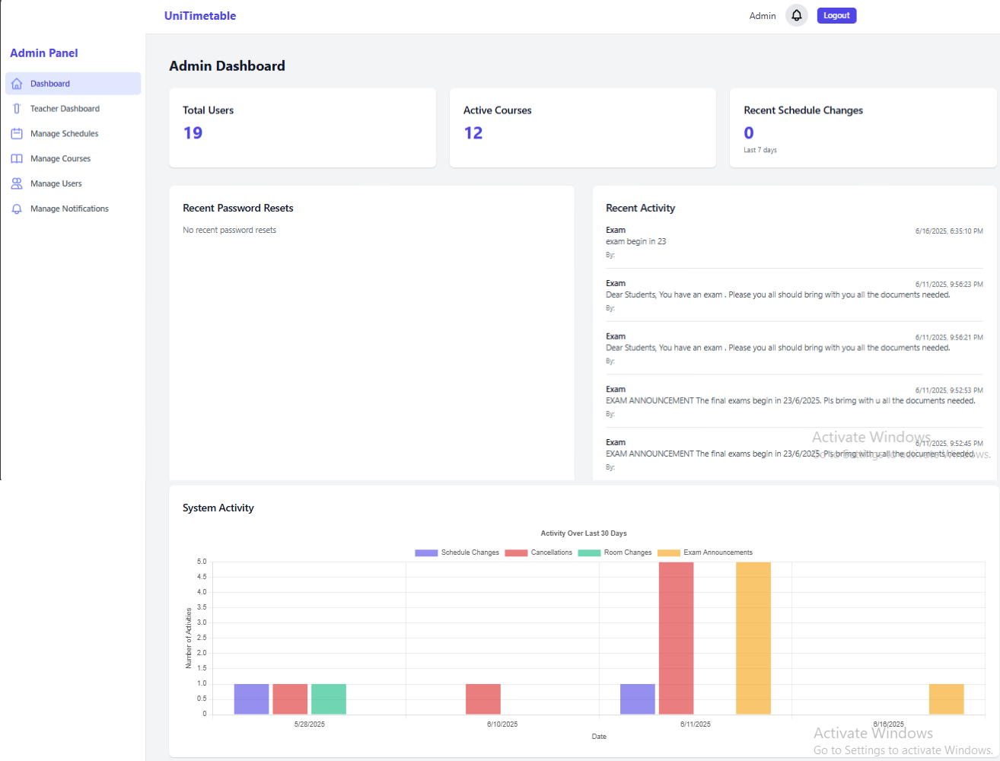
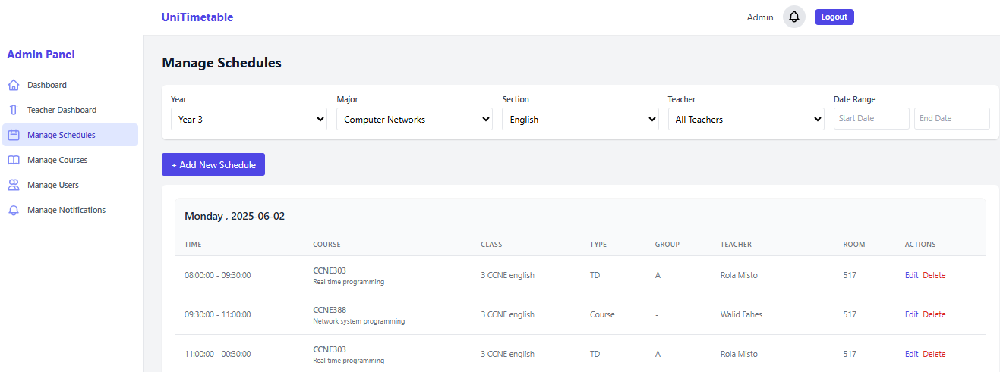
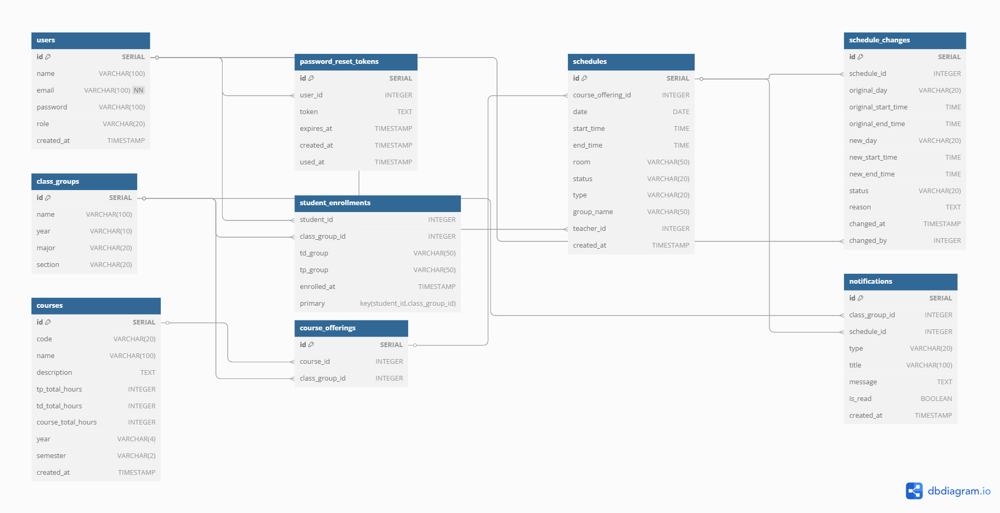

# UniTimetable

A web app for my university (Lebanese University, Faculty of Technology, Saida) where students
and teachers check their timetable and get notified when a class is cancelled, moved or changes room.
Before this, timetables were sent as PDF files by the class delegates, and changes went through
WhatsApp groups.

Senior project of my Bachelor's in Computer & Communication Network Engineering (2024-2025),
supervised by Dr. Samia Bahlak, with guidance from Eng. Mohamed Bahlak and Eng. Rime Bahlak.
The full report is in [`docs/Senior_project_Report.pdf`](docs/Senior_project_Report.pdf).

**In short:** React + TypeScript, Tailwind CSS, Node.js + Express, PostgreSQL, JWT, bcrypt,
email with Nodemailer, Python scripts to load the data.



## What it does

There are three kinds of users: students, teachers and admins.

**Students and teachers**
- See their week as a grid of sessions (Course, TD or TP), with the course, teacher and room.
- Filter by academic year, language, class group, TD group, TP group and a range of weeks.
- A notification bell shows cancellations, reschedules, room changes and exam announcements.

**Admins**
- **Dashboard:** number of users and courses, recent activity, and a chart of the schedule changes.
- **Course session dashboard:** for each course, how many sessions are done out of the total
  (Course, TD and TP).
- **Manage schedules:** add, edit, cancel or reschedule sessions, filter by year, major, section,
  teacher and dates. Every change is saved in a history table.
- **Manage courses** and **manage users** (students are placed in a class group with a TD and TP group).
- **Manage notifications:** send a notification to a class group, shown in the app and sent by email.

**Accounts**
- Login with email and password. Passwords are hashed with bcrypt, and the session uses a JWT token.
- Each role only sees its own pages.
- "Forgot password": the user gets an email with a link, and the token in the link expires.

| Admin dashboard | Manage schedules |
|---|---|
|  |  |

## Database

9 PostgreSQL tables, in [`database/schema.sql`](database/schema.sql):



- `users` holds the students, teachers and admins, with a role.
- `class_groups` are the classes (year, major, English or French section), and `student_enrollments`
  puts each student in a class group with a TD and TP group.
- `courses` are linked to class groups through `course_offerings`, and each session of a course is a
  row in `schedules` (date, start and end time, room, type, group, teacher).
- `schedule_changes` keeps the history of cancellations and reschedules, `notifications` the messages
  sent to class groups, and `password_reset_tokens` the reset links.

The data (class groups, admins, teachers, students) was loaded with the Python scripts in
[`database/injection/`](database/injection/), which read CSV files. The CSV files are not in this
repo because they contain real names and emails.

## Run it

You need Node.js and PostgreSQL.

```bash
# 1. database
createdb unitimetable
psql -d unitimetable -f database/schema.sql

# 2. backend (port 8080)
cd backend
cp .env.example .env      # fill in the database login, a JWT secret and an email account
npm install
npm start

# 3. frontend (port 3000)
cd ../frontend
npm install
npm start
```

The frontend calls the backend at `http://localhost:8080`.

## Files

```
frontend/src/pages/       login, reset password, student and teacher schedules, admin pages
frontend/src/components/  navbar, admin sidebar, notification bell
frontend/src/services/    calls to the backend API
backend/src/routes/       API routes
backend/src/controllers/  logic for auth, users, courses, schedules, notifications, emails, dashboards
backend/src/middleware/   checks the JWT token and the admin role
database/schema.sql       the tables
database/injection/       Python scripts that loaded the data from CSV files
docs/                     report and screenshots
```

## How it was built

I worked in weekly cycles, with a meeting every week to show progress and get feedback. The code was
on GitLab with a `frontend-update` branch, a `backend-update` branch, and `main` for the stable version.
The APIs were tested with Postman during development.
